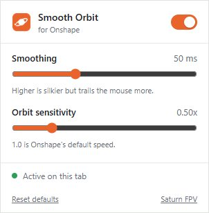

# Smooth Orbit for Onshape

[]([CHROME_WEB_STORE_URL](https://chromewebstore.google.com/detail/smooth-orbit-for-onshape/hidlnmolgcpapjcngcjkliiimmanpkke))
[](FIREFOX_ADDONS_URL)
[](https://github.com/saturn-fpv/smooth-orbit-for-onshape/releases/latest)
[](https://github.com/saturn-fpv/smooth-orbit-for-onshape/actions/workflows/release.yml)
[](LICENSE)

Browser extension that removes the per-pixel stepping when orbiting in
[Onshape](https://www.onshape.com), so the view rotates smoothly.



## How it works

Onshape rounds mouse input to whole pixels and rotates about 0.6° per pixel,
so slow orbits move in visible jumps. The extension hooks Onshape's view
manipulator and replays each pixel step as many small fractional steps through
Onshape's own rotation code. Pan, zoom and selection are untouched.

## Usage

- Toolbar popup: on/off, smoothing (ms), orbit sensitivity.
- **F8** in Onshape toggles smoothing for a quick before/after comparison.
- Green status dot means the extension is hooked into the 3D view.

## Install from source

One codebase for both browsers, in [`src/`](src).

- **Chrome:** `chrome://extensions` → Developer mode → *Load unpacked* → `src/`
- **Firefox:** `about:debugging#/runtime/this-firefox` → *Load Temporary Add-on* → `src/manifest.json`

Requires Chrome 111+ or Firefox 128+.

Lint and package (one zip for both stores, written to `dist/`):

```bash
npx web-ext lint -s src
npx web-ext build -s src -a dist
```

Release: bump `version` in `src/manifest.json`, commit, then push a matching
tag (`git tag v1.0.2 && git push origin v1.0.2`). The release workflow builds
the zip and attaches it to a GitHub Release.

## Privacy

No data is collected or sent anywhere. The only permission is `storage`, for
your settings. It runs only on `cad.onshape.com`.

## If it stops working

It relies on Onshape internals. If an Onshape update changes them, the
extension does nothing and logs `[SmoothOrbit] view manipulator not found` in
the DevTools console. Please open an issue.

## License

[GPL-3.0](LICENSE). Not affiliated with Onshape or PTC.
